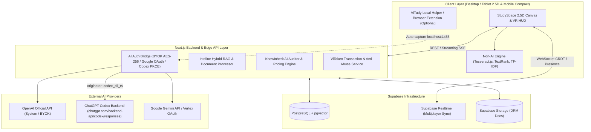
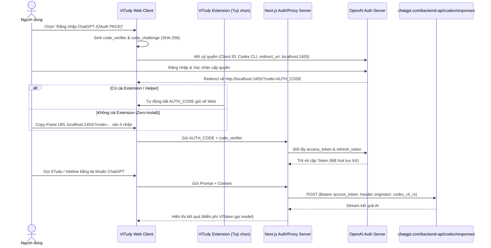
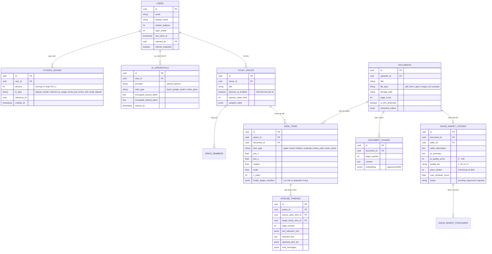

# TÀI LIỆU ĐẶC TẢ YÊU CẦU PHẦN MỀM (SRS)
## Dự án: **ViTudy — Không Gian Học Thức Tích Hợp AI (AI-Powered Interactive Study Space)**
**Phiên bản:** 1.0.0  
**Tiêu chuẩn áp dụng:** IEEE 830 / Agile Product Specification  
**Trạng thái:** Đã chốt yêu cầu (Baseline Approved)

---

## 1. GIỚI THIỆU TỔNG QUAN (INTRODUCTION)

### 1.1. Mục đích (Purpose)
Tài liệu này đặc tả toàn bộ yêu cầu nghiệp vụ, chức năng, kiến trúc kỹ thuật, cơ sở dữ liệu và giao diện người dùng cho nền tảng web **ViTudy**. ViTudy là một không gian học tập số hóa mô phỏng mặt bàn thực tế theo góc nhìn 2.5D kết hợp HUD kiểu kính thực tế ảo (VR), cung cấp bộ công cụ tự học thông minh hoạt động độc lập (Non-AI) lẫn tích hợp sâu các mô hình ngôn ngữ lớn (AI), đi kèm nền kinh tế chia sẻ tri thức qua đơn vị tiền tệ nội bộ **ViToken**.

### 1.2. Phạm vi sản phẩm (Product Scope)
Hệ thống bao gồm 5 trụ cột cốt lõi:
1. **Core Engine (Non-AI & AI Hybrid + ViToken Economy + Dual Auth):** Bộ công cụ xử lý tài liệu cơ bản không tốn phí AI, kết hợp cổng kết nối AI linh hoạt (Hệ thống cấp qua ViToken, tự nhập API Key - BYOK, hoặc đăng nhập OAuth tài khoản cá nhân OpenAI ChatGPT / Google Gemini).
2. **STudy (Học & Ôn Luyện):** Tự động hóa việc tóm tắt, lập lộ trình học dạng sơ đồ cây tương tác (Interactive Node Roadmap), tạo Flashcard (Spaced Repetition) và sinh đề thi trắc nghiệm/tự luận đa phong cách (bao gồm cả hình thức tờ giấy đề thi trực tiếp trên bàn học).
3. **KnowInherit (Kế Thừa Tri Thức):** Chợ chia sẻ tài liệu học tập có kiểm duyệt tự động bằng AI (chống trùng lặp ngữ nghĩa & chấm điểm chất lượng để định giá khung cố định). Chia sẻ doanh thu **85% cho tác giả gốc** và **15% phí nền tảng**.
4. **StudySpace (Không Gian Học Thức 2.5D Multiplayer):** Bàn làm việc vô cực (Infinite 2.5D Canvas) cho phép đặt, xoay, thu phóng, gộp/tách các tờ giấy và cuốn sách, vẽ/highlight trực tiếp, hỗ trợ học nhóm thời gian thực (Real-time Multiplayer) và giao diện HUD 4 góc cùng Contextual Overlay.
5. **Inteline (Trí Tuệ Từng Dòng):** Công cụ hỏi đáp AI ngữ cảnh sâu ngay tại dòng văn bản đang bôi đen hoặc trang sách được chọn, cho phép đính kèm chéo nhiều sách/tờ giấy khác trên bàn học qua cơ chế **Hybrid RAG + Context Caching**, ghim câu trả lời thành ghi chú nối dây trực quan (Visual Link Thread) trên bàn.

---

## 2. KIẾN TRÚC TỔNG THỂ & CÔNG NGHỆ (SYSTEM ARCHITECTURE & TECH STACK)

### 2.1. Định hướng Công nghệ (Unified Full-Stack TypeScript)
Để tối ưu tốc độ phát triển MVP đồng thời đảm bảo khả năng mở rộng cho Real-time Canvas và Vector Search:
* **Frontend & Application Framework:** `Next.js` (App Router, React 19, TypeScript), `TailwindCSS`, `Framer Motion` (chuyển động UI/HUD).
* **2.5D Infinite Canvas & Rendering Engine:** Kết hợp HTML5 Canvas / CSS 3D Transforms tùy biến (hoặc thư viện nền `Konva.js` / `PixiJS` kết hợp DOM Overlay) cùng `PDF.js` (render trang sách sắc nét, giữ lớp Text Layer để bôi đen gọi Inteline) và hiệu ứng lật trang sách 2.5D.
* **Backend & BaaS (Supabase Ecosystem):**
  * **Database:** `Supabase PostgreSQL` tích hợp extension `pgvector` (Vector Embeddings cho Inteline RAG & chống đạo văn/trùng lặp trên KnowInherit).
  * **Authentication:** `Supabase Auth` (Email/Password, Google OAuth, quản lý phiên người dùng).
  * **Real-time Multiplayer:** `Supabase Realtime` (Broadcast & Presence cho đồng bộ con trỏ chuột, trạng thái sách, chat bàn học) kết hợp `Yjs` (CRDT) để đồng bộ vị trí/vẽ tay không xung đột.
  * **File Storage:** `Supabase Storage` (lưu trữ PDF, Docx, PPTX, Ảnh, kèm cơ chế Signed URLs bảo vệ DRM cho tài liệu KnowInherit).
* **Non-AI Processing Pipeline:**
  * **OCR:** `Tesseract.js` (WebAssembly/Worker chạy phía Client hoặc Edge Server).
  * **Document Parsing:** `pdf-parse` / `PDF.js` (PDF), `mammoth` (.docx), `officeparser` (.pptx), `youtube-transcript` + Readability parser (URL/YouTube).
  * **NLP Thống kê:** Thuật toán `TextRank` & `TF-IDF` (trích xuất câu tóm tắt & từ khóa quan trọng), `Regex Heading Parser` (bóc tách cây mục lục Chương/Phần), `Cloze Deletion` (ẩn cụm từ khóa có điểm TF-IDF cao để sinh câu hỏi trắc nghiệm/điền từ không cần LLM).

### 2.2. Sơ đồ Kiến trúc Hệ thống (System Architecture Diagram)



---

## 3. ĐẶC TẢ CHI TIẾT PHÂN HỆ 0: CỐT LÕI (CORE ENGINE, AI AUTH & VITOKEN ECONOMY)

### 3.1. Bộ công cụ cơ bản Không dùng AI (Non-AI Baseline Engine)
Mọi người dùng (kể cả khi hết ViToken và không gắn API Key) đều sử dụng được miễn phí 100% các chức năng cơ bản sau:
1. **Quét chữ từ ảnh (OCR):** Sử dụng `Tesseract.js` hỗ trợ tiếng Việt (`vie`) và tiếng Anh (`eng`) để chuyển ảnh chụp trang sách/vở viết thành văn bản có thể bôi đen và tìm kiếm.
2. **Trích lục cấu trúc (Outline Extraction):** Dùng biểu thức chính quy (Regex) và phân tích cỡ chữ/độ đậm (Font-weight/Font-size heuristics từ PDF/Docx/PPTX) để tự động dựng cây mục lục (Chương, Mục, Tiêu đề).
3. **Tóm tắt thống kê (Extractive Summarization):** Áp dụng thuật toán đồ thị `TextRank` kết hợp trọng số `TF-IDF` để chấm điểm độ quan trọng của từng câu trong văn bản, rút trích ra $N$ câu cốt lõi nhất mà không làm biến đổi câu chữ gốc.
4. **Sinh câu hỏi trắc nghiệm & Flashcard tự động (Rule-based Quiz/Flashcard):**
   * Nhận diện các mẫu câu định nghĩa (ví dụ: *"X là..."*, *"Định nghĩa Y:"*, *"Công thức tính Z:"*) để tách vế câu thành Mặt trước / Mặt sau của Flashcard.
   * Dùng thuật toán **Cloze Deletion** (Đục lỗ từ khóa): Tự động ẩn các cụm danh từ/thuật ngữ có điểm TF-IDF cao nhất trong câu để tạo câu hỏi điền từ, và lấy các cụm thuật ngữ cùng chương làm 3 phương án nhiễu (Distractors) cho câu hỏi trắc nghiệm 4 đáp án.
5. **Lộ trình học cơ bản (Heuristic Study Path):** Chia các chương/mục đã trích lục thành các chặng học dựa trên độ dài văn bản (số từ ước tính theo tốc độ đọc trung bình 200 từ/phút).

### 3.2. Kiến trúc Kết nối AI Đa Chế Độ (Multi-Mode AI Provider Architecture)
Hệ thống hỗ trợ 2 nhà cung cấp giai đoạn đầu là **OpenAI (ChatGPT)** và **Google (Gemini)** qua 3 chế độ cấp quyền:

#### Chế độ 1: Dùng AI của Hệ thống ViTudy (System Managed - Trả bằng ViToken)
* Gọi qua API Key doanh nghiệp của ViTudy.
* Hiển thị bảng giá minh bạch theo từng Model (ví dụ: `GPT-4o mini`, `GPT-4o`, `o3-mini`, `Gemini 2.5 Flash`, `Gemini 2.5 Pro`) với hệ số quy đổi đúng chuẩn giá gốc nhà cung cấp ra đơn vị **ViToken**.

#### Chế độ 2: Người dùng tự cung cấp Khóa (BYOK - Bring Your Own Key)
* Người dùng nhập API Key cá nhân của OpenAI (`sk-...`) hoặc Google AI Studio (`AIza...`).
* Khóa được mã hóa chuẩn **AES-256-GCM** trước khi lưu hoặc lưu cục bộ theo tùy chọn phiên của người dùng.

#### Chế độ 3: Đăng nhập OAuth tài khoản cá nhân (Personal Account OAuth)
1. **Google Gemini OAuth:**
   * Sử dụng luồng OAuth 2.0 chuẩn của Google cấp quyền truy cập phạm vi Gemini/Generative Language của tài khoản người dùng.
2. **ChatGPT OAuth 2.0 PKCE (Cơ chế OpenAI Codex CLI Bridge):**
   * **Nguyên lý:** Tận dụng Client ID chính thức của công cụ `OpenAI Codex CLI` với cơ chế **OAuth 2.0 PKCE** (không cần Client Secret), yêu cầu redirect về `http://localhost:1455/auth/callback` để lấy cặp `access_token` và `refresh_token`, cho phép người dùng tận dụng trực tiếp hạn mức thuê bao **ChatGPT Plus / Team / Pro** sẵn có mà không tốn tiền nạp API riêng.
   * **Giải pháp vượt rào cản trình duyệt Web (Dual Capture Flow):**
     * **Cách A (Zero-Install / Copy-Paste URL):** Người dùng bấm *"Đăng nhập ChatGPT Plus/Pro"*, web mở tab ủy quyền OpenAI. Sau khi bấm đồng ý, trình duyệt chuyển hướng sang `http://localhost:1455/?code=...&state=...` (trang báo không kết nối được localhost). Người dùng chỉ cần copy thanh URL đó dán vào ô xác nhận trên ViTudy.
     * **Cách B (1-Click Auto Capture qua Browser Extension / Local Helper):** Nếu người dùng cài tiện ích mở rộng nhẹ *ViTudy Bridge Extension*, tiện ích sẽ tự động chặn (intercept) request chuyển hướng tới `localhost:1455`, trích xuất `code` và truyền thẳng về tab ViTudy hoàn toàn tự động.
   * **Định tuyến Request (Codex Backend Routing):** Next.js Backend Proxy nhận `access_token`, đính kèm bộ Header định danh chuẩn (`originator: codex_cli_rs`) và gửi request thẳng tới endpoint nội bộ `https://chatgpt.com/backend-api/codex/responses`, trả luồng dữ liệu (SSE Stream) về giao diện ViTudy.



> [!IMPORTANT]
> **Chính sách tính phí khi dùng BYOK / OAuth cá nhân:**
> Khi người dùng sử dụng API Key hoặc OAuth cá nhân, hệ thống **MIỄN PHÍ 100% ViToken cho lượt gọi model AI**. Hệ thống chỉ thu một khoản phí nền tảng rất nhỏ (ví dụ: 0.5 – 1 ViToken) khi người dùng kích hoạt các tác vụ nặng thuộc tài nguyên máy chủ ViTudy như: băm Vector Embeddings hàng loạt cho nhiều sách mới hoặc truy vấn Vector Search đa tài liệu quy mô lớn.

---

### 3.3. Nền kinh tế ViToken & Cơ chế Chống Gian Lận (ViToken Economy & Anti-Abuse)
* **Mô hình tiền tệ:** Tiền tệ nội bộ khép kín (**Closed-loop Token**). Hỗ trợ nạp thêm qua cổng thanh toán (Top-up) nhưng **không hỗ trợ quy đổi ngược ra tiền mặt (No Cash-out)** nhằm đảm bảo tuân thủ pháp lý và chống rửa tiền.
* **Nguồn nhận ViToken miễn phí & Luật chống cày tài khoản ảo (Anti-Sybil / Anti-Clone):**
  1. **Quà khởi tạo tài khoản:** Tặng **50 ViToken** chỉ sau khi tài khoản hoàn tất xác thực Email + Số điện thoại (hoặc OAuth uy tín kèm Device Fingerprinting).
  2. **Điểm danh chuỗi ngày (Daily Login Streak):** Nhận từ **2 đến 10 ViToken/ngày** lũy tiến theo chuỗi 7 ngày liên tiếp (yêu cầu mở bàn học tương tác tối thiểu 3 phút để tính điểm danh hợp lệ).
  3. **Giới thiệu bạn bè (Referral Milestone):** Khi người dùng A mời người dùng B, cả A và B chỉ nhận được thưởng giới thiệu khi **B đã xác thực tài khoản VÀ hoàn thành ít nhất 1 phiên học thực tế** (tải tài liệu lên và sử dụng STudy/Inteline hợp lệ).
  4. **Sự kiện & Đóng góp:** Nhận thêm qua sự kiện học tập hoặc bán tài liệu chất lượng trên chợ **KnowInherit** (nhận 85% giá bán mỗi lượt mở khóa).

---

## 4. ĐẶC TẢ CHI TIẾT PHÂN HỆ 1: STudy (HỌC & ÔN LUYỆN)

### 4.1. Tiếp nhận & Xử lý Đa định dạng Tài liệu (Multi-format Ingestion)
Hỗ trợ kéo thả trực tiếp từ File Explorer của máy tính, chọn từ kho tài liệu hoặc dán liên kết vào bàn học với các định dạng MVP:
* **Tài liệu văn bản & Bố cục:** `.pdf`, `.docx`, `.pptx`, `.md`, `.txt`.
* **Hình ảnh:** `.png`, `.jpg`, `.webp` (tự động kích hoạt pipeline OCR).
* **Liên kết trực tuyến:** URL bài báo/tài liệu web (tự động lọc bỏ quảng cáo lấy nội dung chính) và **Link YouTube** (tự động trích xuất phụ đề/transcript kèm mốc thời gian timestamp).

### 4.2. Tóm tắt Đa Chế Độ & Lộ trình học Tương tác (Summaries & Interactive Roadmap)
1. **Tóm tắt linh hoạt:**
   * Chọn nguồn xử lý: **Non-AI (Miễn phí)** hoặc **AI (Tuỳ chọn Model & Giới hạn phạm vi trang/chương)**.
   * Định dạng đầu ra: Văn bản thuần phân cấp (Bullet points), Bảng đối chiếu khái niệm, Sơ đồ tư duy tóm tắt, hoặc bộ **Flashcard** (tích hợp thuật toán lặp lại ngắt quãng *Spaced Repetition SM-2*).
2. **Lộ trình học dạng Sơ đồ cây tương tác (Interactive Node Roadmap):**
   * Xuất hiện như một tấm bảng thông minh ghim ngay cạnh cuốn sách trên bàn StudySpace.
   * Mỗi nút (Node) đại diện cho một Chương/Chặng kiến thức, hiển thị thời lượng học dự kiến và trạng thái hoàn thành (Checkbox tích xanh).
   * **Liên kết sâu (Deep Linking):** Bấm vào một Node trên lộ trình sẽ tự động lật cuốn sách trên bàn tới đúng trang bắt đầu của chương đó, đồng thời cung cấp nút bấm nhanh *"Tạo Flashcard chặng này"* hoặc *"Kiểm tra 5 phút chặng này"*.

### 4.3. Hệ thống Sinh Đề Ôn Thi & Tờ Đề Thi Giấy (Exam Generator & Paper Exam Sheet)
* **Các loại câu hỏi hỗ trợ:** Trắc nghiệm 4 lựa chọn (MCQ), Đúng/Sai nhiều mệnh đề (True/False), Điền từ vào chỗ trống (Fill-in-the-blank), và Tự luận ngắn (Short Answer - dùng AI chấm điểm theo ý).
* **Chế độ trải nghiệm làm bài:**
  1. **Chế độ Luyện tập (Practice Mode):** Trả lời câu nào báo đúng/sai và hiện giải thích chi tiết (kèm trích dẫn trang sách gốc) ngay câu đó.
  2. **Chế độ Phòng thi (Timed Exam Mode):** Đếm ngược thời gian, khóa tra cứu tài liệu trên bàn (tuỳ chọn), nộp bài mới chấm tổng điểm và phân tích lỗ hổng kiến thức.
  3. **Giao diện "Tờ Đề Thi Giấy" trên bàn học (Physical Exam Paper Sheet):** Đề thi được sinh ra dưới dạng một tờ giấy A4 thực thụ đặt ngay trên mặt bàn StudySpace. Người dùng có thể dùng bút khoanh tròn đáp án A/B/C/D trực tiếp trên tờ giấy đề thi và bấm *"Chấm bài"* ở góc tờ giấy.

---

## 5. ĐẶC TẢ CHI TIẾT PHÂN HỆ 2: KnowInherit (KẾ THỪA TRI THỨC)

### 5.1. Quy trình Kiểm duyệt Tự động bằng AI & Chống Spam (AI Auditing & Anti-Spam)
Khi người đi trước chia sẻ tài liệu lên kho **KnowInherit**, hệ thống vận hành luồng kiểm duyệt tự động:

```mermaid
flowchart LR
    A["Người chia sẻ tải tài liệu lên"] --> B{"Kiểm tra hạn mức đăng ngày"}
    B -->|<= 3 lượt/ngày| C["Miễn phí cọc kiểm duyệt"]
    B -->|> 3 lượt/ngày| D["Tạm giữ cọc 1-2 ViToken"]
    C --> E["Quét Vector Similarity (pgvector)"]
    D --> E
    E -->|Trùng lặp > 80%| F["Từ chối đăng & Thu cọc (nếu có)"]
    E -->|Trùng lặp <= 80%| G["AI chấm điểm Chất lượng (0-100)"]
    G -->|Điểm < 40 (Rác/Sơ sài)| F
    G -->|Điểm >= 40| H["Áp giá khung cố định (5 - 50 ViToken) + Hoàn cọc"]
    H --> I["Niêm yết lên Chợ KnowInherit"]
```

1. **Chống Spam chi phí kiểm duyệt:** Mỗi tài khoản được miễn phí kiểm duyệt **3 lượt tải lên đầu tiên mỗi ngày**. Từ lượt thứ 4 trong ngày, người dùng phải đặt cọc **1–2 ViToken**; nếu tài liệu đạt chuẩn được duyệt lên chợ, hệ thống **hoàn trả 100% tiền cọc** ngay lập tức (nếu cố tình đăng tài liệu rác/trùng lặp sẽ mất cọc).
2. **Kiểm tra Trùng lặp Ngữ nghĩa (Semantic Deduplication):** Hệ thống băm nhỏ nội dung thành Vector Embeddings qua `pgvector` và so khớp với toàn bộ kho KnowInherit. Nếu độ tương đồng ngữ nghĩa vượt quá **80%**, hệ thống tự động chặn đăng và báo trùng lặp.
3. **Chấm điểm Chất lượng & Định giá Khung cố định (AI Fixed-Tier Pricing):**
   * AI đánh giá tài liệu trên thang **100 điểm** dựa trên 4 tiêu chí: *Độ sâu kiến thức (35%)*, *Cấu trúc & Trình bày (25%)*, *Độ chính xác/Rõ ràng (25%)*, và *Tính độc bản (15%)*.
   * Tài liệu dưới **40 điểm** bị từ chối.
   * Tài liệu từ **40 – 100 điểm** được phân vào các hạng chất lượng (Tier C, B, A, S) và **tự động áp mức giá ViToken theo khung cố định của hệ thống** (ví dụ: Hạng C = 5 ViToken, Hạng B = 15 ViToken, Hạng A = 30 ViToken, Hạng S = 50 ViToken) để đảm bảo công bằng, tránh thổi giá hoặc phá giá.

### 5.2. Xem trước, Giao dịch Chia sẻ Doanh thu (85/15) & Bảo vệ Bản quyền (DRM)
* **Trải nghiệm Xem trước (Preview):** Người mua được xem miễn phí: Trang bìa, Mục lục tự động, Bản tóm tắt tổng quan do AI viết, **10%–15% số trang đầu** (có che mờ một phần nội dung quan trọng), cùng Bảng điểm đánh giá chi tiết của AI và nhận xét/sao từ người mua trước.
* **Phân chia Doanh thu:** Khi người đi sau chi ViToken mở khóa tài liệu:
  * **85% số ViToken** được cộng trực tiếp vào ví của người chia sẻ gốc.
  * **15% số ViToken** thuộc về doanh thu nền tảng ViTudy.
* **Cơ chế Bảo vệ Người mua (Escrow 24h):** Nếu tài liệu bị lỗi hiển thị nghiêm trọng hoặc sai lệch hoàn toàn so với mô tả, người mua có quyền bấm *"Khiếu nại"* trong vòng **24 giờ đầu** để AI/Admin đối soát và hoàn lại ViToken.
* **Quyền hạn & DRM sau khi mua:** Tài liệu mở khóa sẽ bay thẳng vào bàn học **StudySpace** của người mua dưới dạng một Cuốn sách/Tờ giấy có gắn **Watermark định danh ẩn (User ID Watermark)**. Người mua được dùng toàn bộ tính năng STudy, Inteline, vẽ highlight thoải mái bên trong web nhưng **bị khóa tính năng tải file gốc (PDF/Docx) về máy tính** và **cấm đăng bán lại lên KnowInherit**.

---

## 6. ĐẶC TẢ CHI TIẾT PHÂN HỆ 3: StudySpace (KHÔNG GIAN HỌC THỨC 2.5D MULTIPLAYER)

### 6.1. Không gian Bàn học 2.5D Vô cực & Vật thể Tài liệu (2.5D Infinite Desk & Objects)
* **Đa bàn học (Multiple Spaces):** Người dùng tạo được nhiều bàn học riêng biệt theo từng môn học hoặc kỳ thi. Mọi tọa độ $(x, y, z\text{-index})$, góc xoay ($\theta$), mức phóng đại (zoom scale) và trang sách đang mở đều được tự động lưu đồng bộ lên Cloud.
* **Phân loại Vật thể Tự động (Paper vs. Book Rule):**
  * **Tờ giấy rời (Paper Sheet):** Tài liệu từ **1 đến 4 trang** (hoặc ảnh lẻ, ghi chú, tờ đề thi) hiển thị dưới dạng các tờ giấy phẳng có bóng đổ nhẹ trên mặt bàn, có thể xếp chồng hoặc rải tự do.
  * **Cuốn sách (Book):** Tài liệu từ **5 trang trở lên** tự động đóng thành một cuốn sách có bìa, độ dày gáy sách tỷ lệ thuận với số trang, mở 2 trang song song (Spread View) kèm hiệu ứng lật trang 2.5D mượt mà.
* **Cơ chế Gộp & Tách Sách linh hoạt (Non-destructive Binder Merging):**
  * Người dùng có thể kéo thả trực tiếp một hoặc nhiều **Tờ giấy rời** thả vào trang đang mở của một **Cuốn sách** (hoặc gom nhiều tờ giấy bấm *"Đóng thành sách"*).
  * Cuốn sách sẽ hoạt động như một **Sổ còng tổng hợp (Binder)**: chèn tờ giấy vào đúng thứ tự trang mong muốn nhưng vẫn giữ nguyên lịch sử nguồn gốc (Metadata) của từng tờ, cho phép người dùng **kéo rút rời từng trang giấy ra lại mặt bàn** bất cứ lúc nào mà không làm hỏng file gốc.

### 6.2. Hệ thống Giao diện Kép: VR HUD (4 Góc Cố Định) & Contextual Overlay
Giao diện loại bỏ các thanh menu truyền thống rườm rà, thay bằng trải nghiệm đắm chìm như kính VR:

| Vị trí / Loại UI | Thành phần hiển thị & Chức năng chính |
| :--- | :--- |
| **Góc Trái - Trên (HUD 1)** | **Điều hướng & Quản lý Không gian:** Chuyển đổi nhanh giữa các bàn học (Spaces), danh sách thành viên đang online trong bàn (Multiplayer Avatars), nút bật/tắt chế độ *Follow Me*, và thanh Tìm kiếm toàn cục (`Ctrl+F` tìm xuyên suốt mọi cuốn sách trên bàn và tự bay camera tới trang chứa từ khóa). |
| **Góc Phải - Trên (HUD 2)** | **Ví ViToken & Trung tâm AI:** Hiển thị số dư ViToken theo thời gian thực, chuỗi điểm danh ngày, nút chuyển đổi nhanh chế độ AI (*System ViToken* / *BYOK* / *ChatGPT Codex OAuth* / *Gemini OAuth*) và chọn Model AI. |
| **Góc Trái - Dưới (HUD 3)** | **Kho Tri Thức & Chợ KnowInherit:** Ngăn kéo mở nhanh kho tài liệu đã tải lên, giỏ hàng & cửa sổ lướt chợ tài liệu *KnowInherit* mà không cần rời khỏi bàn học. |
| **Góc Phải - Dưới (HUD 4)** | **Minimap, Camera & Hộp bút Bàn học:** Bản đồ thu nhỏ (Minimap) toàn cảnh bàn học, thanh điều chỉnh Zoom/Reset góc nhìn, công cụ tạo Sticky Note, Bút dạ quang (Highlight), Bút vẽ tay tự do (Freehand Pen) và Nhãn dán đánh dấu trang (Bookmark Tab). |
| **Contextual Overlay (Linh động)** | **Menu bám viền & Nội tuyến:** Khi chạm hoặc zoom vào một cuốn sách/tờ giấy, thanh công cụ mỏng sẽ nổi lên ngay sát viền vật thể đó (Gọi STudy tóm tắt, Tạo đề thi, Lật trang nhanh, Tách trang); khi bôi đen văn bản, nút **Inteline** nổi lên ngay tại con trỏ. |

### 6.3. Cộng tác Thời gian thực (Real-time Multiplayer StudySpace)
* **Phân quyền 3 cấp độ:** `Owner` (Chủ bàn), `Editor` (Thành viên cùng học: được thêm tài liệu, dán note, vẽ, lật sách), `Viewer` (Chỉ xem).
* **Chế độ Góc nhìn Độc lập kết hợp Đồng bộ Thuyết trình (Local View + Follow Me Sync):**
  * **Mặc định (Local View):** Để tránh làm phiền nhau khi học nhóm, ai bấm lật trang cuốn sách hoặc zoom góc nào thì chỉ thay đổi góc nhìn trên màn hình của người đó.
  * **Chế độ Thuyết trình / Giảng bài (Follow Me / Sync Page):** Khi một thành viên bấm nút *"Đồng bộ góc nhìn"* (hoặc *Ping* vào một đoạn văn bản), camera và trang sách của các thành viên đang bật theo dõi sẽ tự động bay tới đúng vị trí và trang sách đó.
* **Cơ chế tính phí AI & Bảo vệ tài liệu KnowInherit trong bàn chung:**
  * **Ai gọi người nấy trả (Default):** Thành viên nào bấm gọi STudy hoặc Inteline thì trừ ViToken (hoặc dùng Key/OAuth) của chính thành viên đó.
  * **Quỹ bàn học chung (Host Sponsor Toggle):** Chủ bàn (`Owner`) có nút gạt cho phép tài trợ ViToken (hoặc cho mượn luồng AI của Chủ bàn) với hạn mức đặt trước cho các thành viên trong phiên học nhóm.
  * **Quyền xem sách KnowInherit:** Nếu Chủ bàn đặt một cuốn sách mua từ *KnowInherit* lên bàn học chung, các thành viên trong bàn được phép đọc chung khi đang ở trong bàn đó, nhưng **không thể sao chép (Clone/Copy) cuốn sách đó về bàn học cá nhân của họ** nếu chưa trả ViToken mở khóa.

### 6.4. Tương thích Thiết bị (Responsive Cross-Device Strategy)
* **Desktop / Laptop & Tablet ngang (Chính):** Trải nghiệm đầy đủ 100% không gian bàn học 2.5D Infinite Canvas, HUD 4 góc, kéo thả đa điểm và bút cảm ứng (Stylus/Apple Pencil).
* **Điện thoại di động (Mobile Companion Mode):** Tự động chuyển sang giao diện **"Chế độ Đọc & Ôn tập thu gọn"** (Danh sách tài liệu dạng thẻ dọc, lướt ôn Flashcard, làm bài trắc nghiệm nhanh, đọc ghi chú Inteline và dạo chợ KnowInherit) thay vì ép người dùng thao tác bàn học 2.5D trên màn hình dọc nhỏ hẹp.

---

## 7. ĐẶC TẢ CHI TIẾT PHÂN HỆ 4: Inteline (TRÍ TUỆ TỪNG DÒNG)

### 7.1. Kích hoạt & Đính kèm Ngữ cảnh Chéo (Contextual Trigger & Cross-Document Attachment)
1. **Cách kích hoạt:**
   * Người dùng bôi đen bất kỳ đoạn văn bản nào (hoặc khoanh vùng một bức ảnh/công thức toán) trên tờ giấy/cuốn sách $\rightarrow$ Bấm biểu tượng **Inteline** nổi lên.
   * Hoặc gõ trực tiếp số trang/chương cần hỏi trên thanh lệnh nhanh của cuốn sách.
2. **Đính kèm chéo tài liệu trên bàn (Multi-Object Context):**
   * Ngay trên cửa sổ Overlay của Inteline, người dùng có thể kéo thả hoặc tích chọn thêm các **Tờ giấy khác** hoặc **Cuốn sách khác** đang nằm trên bàn StudySpace (thậm chí chọn rõ trang $X$ đến trang $Y$ của cuốn sách B) để yêu cầu AI đối chiếu, giải thích chéo.

### 7.2. Cơ chế Hybrid RAG, Context Caching & Công thức tính ViToken
* **Luồng xử lý dữ liệu thông minh (Hybrid RAG):**
  * Thay vì nhồi toàn bộ hàng trăm trang của các cuốn sách đính kèm vào Prompt gây tốn kém cực lớn, hệ thống giữ nguyên văn **đoạn văn bản đang bôi đen** + **các trang chỉ định trực tiếp**, sau đó dùng câu hỏi của người dùng + đoạn bôi đen để truy vấn **Vector Search (`pgvector`)** lấy ra đúng $K$ đoạn văn bản liên quan nhất từ các cuốn sách đính kèm.
  * Kích hoạt **Context Caching** (Prompt Caching của OpenAI/Gemini) cho các tài liệu được hỏi lặp đi lặp lại trong cùng một phiên học để giảm tới 50%–75% chi phí token đầu vào.
* **Công thức khấu trừ ViToken minh bạch:**
  $$\text{Chi phí ViToken} = \left( \text{Token Đầu Vào Thực Tế} \times \alpha_{\text{model}} + \text{Token Đầu Ra} \times \beta_{\text{model}} \right) + \left( N_{\text{sách đính kèm}} \times \gamma_{\text{RAG}} \right)$$
  *(Trong đó: Nếu người dùng dùng BYOK hoặc OAuth cá nhân thì $\alpha_{\text{model}} = \beta_{\text{model}} = 0$, chỉ tính phí truy vấn $\gamma_{\text{RAG}}$ rất nhỏ nếu đính kèm nhiều sách).*

### 7.3. Lưu trữ Giải đáp & Sợi Dây Liên Kết Tri Thức (Visual Link Thread & Sticky Pin)
* Sau khi AI trả lời xong trên cửa sổ Inteline, đoạn văn bản được hỏi sẽ được tô sáng nhẹ.
* Người dùng có thể bấm nút **"Ghim ra bàn học" (Pin to Desk)**: Câu trả lời của AI sẽ biến thành một **Tờ giấy ghi chú (Sticky Callout Card)** đặt ngay cạnh cuốn sách trên mặt bàn StudySpace, được nối trực tiếp với dòng văn bản gốc bên trong trang sách bằng một **Sợi dây chỉ thị giác (Visual Link Thread - đường cong Bézier động)**. Khi lật sang trang đó, sợi dây sẽ tự động hiện lên nối từ dòng chữ ra tờ ghi chú giúp người học nhìn thấy ngay mối liên hệ kiến thức.

---

## 8. THIẾT KẾ CƠ SỞ DỮ LIỆU (SUPABASE POSTGRESQL + PGVECTOR SCHEMA)

Dưới đây là thiết kế các bảng dữ liệu cốt lõi trong PostgreSQL:



---

## 9. YÊU CẦU PHI CHỨC NĂNG (NON-FUNCTIONAL REQUIREMENTS)

1. **Hiệu năng Đồ họa 2.5D (Canvas Performance):**
   * Bàn học StudySpace phải duy trì tốc độ khung hình **60 FPS** khi kéo, xoay, thu phóng với tối đa **50 vật thể (tờ giấy/cuốn sách)** trên cùng một mặt bàn thông qua cơ chế **Viewport Culling** (chỉ render chi tiết lớp chữ PDF của những trang nằm trong vùng nhìn thấy của camera, các vật thể ở xa hoặc thu nhỏ tự động chuyển sang ảnh Thumbnail độ phân giải thấp - LOD).
2. **Bảo mật & Quyền riêng tư (Security & DRM):**
   * Toàn bộ API Key và OAuth Token (`access_token`, `refresh_token` của ChatGPT Codex và Google Gemini) bắt buộc mã hóa **AES-256-GCM** ở tầng Server trước khi lưu vào bảng `AI_CREDENTIALS`.
   * Tài liệu từ chợ **KnowInherit** không bao giờ trả về trực tiếp file PDF gốc qua URL công khai mà được phục vụ theo từng trang đã nhúng thủy vân (Watermark User ID) để ngăn chặn trích xuất file hàng loạt.
   * Áp dụng **Row-Level Security (RLS)** trên toàn bộ các bảng của Supabase PostgreSQL để đảm bảo người dùng chỉ truy cập được đúng bàn học và tài liệu họ có quyền.
3. **Độ trễ Thời gian thực (Multiplayer Latency):**
   * Độ trễ cập nhật vị trí con trỏ chuột, thao tác kéo vật thể và lệnh *Follow Me* giữa các thành viên trong cùng một StudySpace dưới **100ms** qua kênh Supabase Realtime Broadcast.

---

## 10. LỘ TRÌNH TRIỂN KHAI ĐỀ XUẤT (IMPLEMENTATION PHASES)

* **Phase 1 — Foundation & StudySpace 2.5D Core:** Dựng khung Next.js + Supabase, hệ thống Auth, ví ViToken cơ bản, và mặt bàn 2.5D Infinite Canvas hỗ trợ ném file PDF/Ảnh/Docx hiển thị thành Tờ giấy (<5 trang) và Cuốn sách ($\ge 5$ trang), lật trang, gộp/tách trang sách (Binder) và 4 góc HUD cố định.
* **Phase 2 — Non-AI Baseline & Multi-Mode AI Bridge:** Tích hợp OCR (`Tesseract.js`), trích lục mục lục, tóm tắt `TextRank/TF-IDF`, tạo câu hỏi `Cloze Deletion` không cần AI. Xây dựng cổng kết nối AI: Hệ thống ViToken, BYOK, Google OAuth và luồng **ChatGPT OAuth 2.0 PKCE (`localhost:1455` / `codex_cli_rs`)**.
* **Phase 3 — STudy & Inteline (RAG + Visual Link Thread):** Hoàn thiện Sơ đồ lộ trình học tương tác, Tờ đề thi giấy trên bàn học, và tính năng bôi đen **Inteline** kèm đính kèm đa sách, Vector Search (`pgvector`) và ghim ghi chú nối dây chỉ trực quan trên bàn.
* **Phase 4 — KnowInherit Marketplace & Multiplayer:** Mở chợ chia sẻ tài liệu KnowInherit với AI kiểm duyệt tự động (chấm điểm định giá khung cố định, chống trùng lặp >80%, chia doanh thu 85/15) và nâng cấp bàn học lên **Real-time Multiplayer** cùng giao diện Mobile thu gọn.
