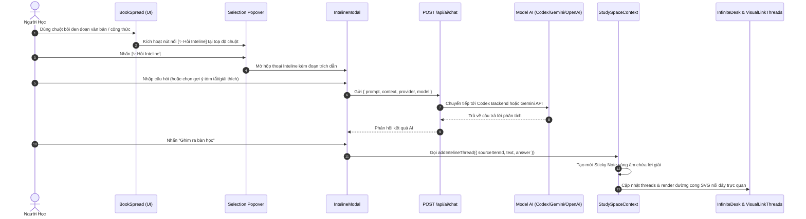
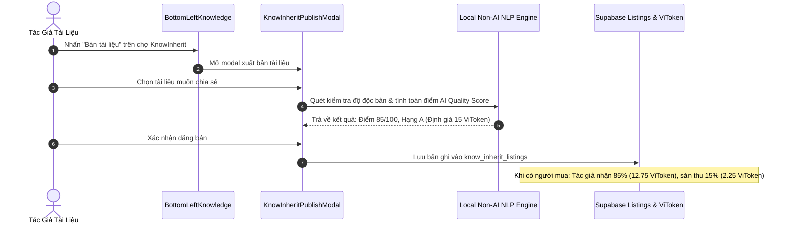

# 07_STATE_AND_DATAFLOW.md — Quản Lý Trạng Thái & Luồng Dữ Liệu ViTudy

> **Commit Hash:** `74d4cc0`  
> **Cập nhật lần cuối:** `2026-11-07`

---

## 1. Các Trạng Thái Toàn Cục (Global Contexts)

### 1. `StudySpaceContext`
* **Vị trí file:** [`src/context/StudySpaceContext.tsx:L1-L620`](file:///F:/AppMaking/ViTudy/src/context/StudySpaceContext.tsx#L1-L620)
* **Trạng thái cốt lõi:**
  * `spaces: StudySpace[]`: Danh sách bàn học của người dùng.
  * `activeSpaceId: string`: ID bàn học hiện hành.
  * `transform: CanvasTransform`: Toạ độ camera `{ x, y, scale }`. Mặc định `{ x: 0, y: 0, scale: 1.0 }`.
  * `selectedItemId: string | null`: ID vật thể đang được chọn (đưa lên `zIndex` cao nhất).
  * `activeTool: 'cursor' | 'pen' | 'highlighter' | 'eraser'`: Công cụ tương tác bàn học.
  * `strokes: DrawingStroke[]`: Danh sách nét vẽ tay và dạ quang trên mặt bàn.
  * `threads: IntelineThread[]`: Danh sách dây nối trực quan từ sách sang ghi chú.
* **Cơ chế lưu trữ:** Tự động đồng bộ vào `localStorage['vitudy_spaces']` kết hợp hàm chuẩn hóa sâu `text.normalize('NFC')`.

### 2. `ViTokenContext`
* **Vị trí file:** [`src/context/ViTokenContext.tsx:L1-L177`](file:///F:/AppMaking/ViTudy/src/context/ViTokenContext.tsx#L1-L177)
* **Trạng thái cốt lõi:**
  * `wallet: ViTokenWallet`: Số dư token (mặc định tặng 50 khi bắt đầu), chuỗi điểm danh streak, lịch sử giao dịch.
  * `aiConfig: AiConfig`: Cấu hình nhà cung cấp AI (`system`, `byok_openai`, `byok_gemini`, `oauth_chatgpt`), model đã chọn, token xác thực.
* **Cơ chế lưu trữ:** Tự động đồng bộ vào `localStorage['vitudy_wallet']` và `localStorage['vitudy_ai_config']`.

---

## 2. Sơ Đồ Luồng Dữ Liệu Tác Vụ Điển Hình (Dataflow Workflows)

### Luồng 1: Bôi Đen Văn Bản Trong Sách $\rightarrow$ Gọi Inteline $\rightarrow$ Ghim Note Nối Dây



---

### Luồng 2: Thao Tác Vẽ Tự Do Bút Dạ Quang & Phím Tắt Alt + Drag

```mermaid
flowchart TD
    Start["Người dùng nhấn chọn Bút Vẽ / Bút Dạ Quang trên HUD"] --> CheckTool{"Công cụ đang chọn?"}
    CheckTool -->|pen / highlighter| MouseDown["Người dùng nhấn chuột xuống mặt bàn"]
    
    MouseDown --> AltCheck{"Đang giữ phím Alt?"}
    AltCheck -->|Có (Alt + Drag)| Pan["Di chuyển góc nhìn bàn học (Pan Canvas)"]
    AltCheck -->|Không (Kéo chuột tự do)| Draw["DeskDrawingInteractionLayer bắt điểm"]
    
    Draw --> StreamPoint["appendPoint({ x, y }) đẩy toạ độ thế giới vào currentStroke"]
    StreamPoint --> Render["DeskDrawingCanvas vẽ đường path SVG tức thì (mix-blend-mode: multiply)"]
    Render --> MouseUp["Nhả chuột: finishStroke() lưu vào strokes mảng toàn cục"]
```

---

### Luồng 3: Xuất Bản Tài Liệu Lên Chợ KnowInherit 85/15


