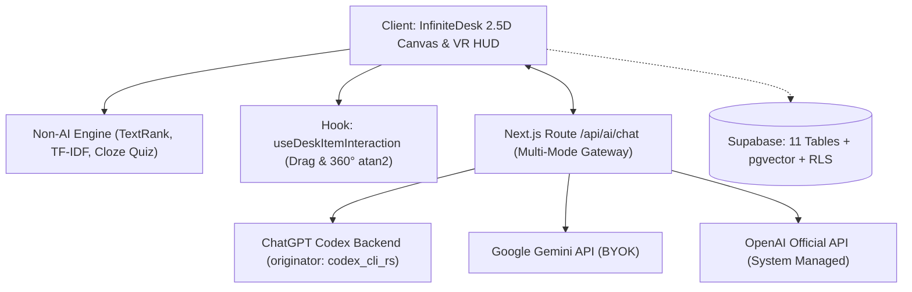

# SNAPSHOT.md — Bản Tiêu Hóa Dự Án Toàn Diện ViTudy

> **Commit Hash:** `Current Working Tree (Production Ready)` | **Ngày cập nhật:** `2026-11-08` | **Tác giả:** Senior Staff Engineer

---

## 1. Tóm Tắt Dự Án & Sức Khỏe Repo (Health Summary)
* **Định nghĩa (5 dòng):** ViTudy là không gian học thức số hóa tích hợp AI mô phỏng mặt bàn thực tế theo góc nhìn 2.5D kết hợp giao diện HUD kiểu kính VR. Nền tảng kết hợp động cơ xử lý học thuật độc lập không tốn phí (Non-AI: OCR, TextRank, Cloze Quiz, Flashcard), cổng kết nối đa mô hình AI (ChatGPT Codex, Gemini BYOK, OpenAI System) qua tiền tệ ViToken, và chợ tri thức KnowInherit 85/15.
* **Giai đoạn phát triển:** Hoàn thành toàn diện: Chuẩn monochromatic, Zero-Emoji 100% SVG, Sách 980x640 da nâu, Hook tương tác xoay 360° `useDeskItemInteraction`, Nét vẽ in-document bám vật thể, Chế độ tập trung đọc Focus Mode tự động thu gọn 5 cụm HUD độc lập kèm lẫy kéo gắn liền, Chợ tài liệu với Điểm AI & Xem thử, Modal Chuỗi điểm danh với đếm ngược, Biểu tượng ngọn lửa chuỗi ôm trọn số ngày, và Thẻ Trắc Nghiệm Tương Tác 3D Lật Mặt (`ExamQuizCard`) kích thước 380x490 màu pastel với máy trạng thái lật 2 giai đoạn không để lại khung đen rỗng.
* **Sức khỏe Repo (Health):**
  * `Build`: **Pass** (`pnpm run build:pages` biên dịch sạch 100%, xuất tĩnh `out/` sẵn sàng GitHub Pages).
  * `Docs Check`: **Pass** (`pnpm run docs:check` hợp lệ, 82 symbols hợp lệ).
  * `Chrome DevTools Automated Test`: **Pass** (`node scripts/test-exam-quiz-card.mjs` đạt 100% 6 kịch bản kiểm thử, chụp 5 ảnh bằng chứng).
  * `Server`: **Running** (`http://localhost:3000` 200 OK).

---

## 2. Tech Stack & Lệnh Thực Thi (Stack & Commands)
* **Công nghệ cốt lõi:** Next.js `15.1.7` (App Router), React `19.0.0`, TailwindCSS `3.4.17`, Framer Motion `12.4.7`, Lucide React `1.16.0`, Tesseract.js `7.0.0`, TypeScript `5.7.3`, Supabase PostgreSQL + `pgvector`.
* **Lệnh cơ bản:**
  * `pnpm dev`: Khởi chạy môi trường phát triển local trên cổng 3000.
  * `pnpm build`: Biên dịch production và kiểm tra kiểu TypeScript toàn dự án.
  * `pnpm run docs:index`: Tự động trích xuất ký hiệu và cập nhật chỉ mục tài liệu.
  * `pnpm run docs:check`: Kiểm tra tính hợp lệ và phát hiện ký hiệu stale trong tài liệu.
  * `node scripts/test-chrome-devtools.mjs`: Chạy bộ test tương tác tự động trực tiếp trên Chrome Remote Debugging port 9222.

---

## 3. Sơ Đồ Kiến Trúc & Danh Sách Module (Architecture & Modules)

* **Module 1: 2.5D Infinite Desk (`components/canvas/` & `components/objects/`):** Không gian bàn học vô cực, xoay tự do 360° qua `useDeskItemInteraction`, sách mở đôi 940x630, tờ đề thi tương tác A4 `exam_sheet`, phân trang động, lớp vẽ bút dạ quang.
* **Module 2: VR HUD (`components/hud/`):** 4 góc điều hướng đơn sắc, ví ViToken, chợ tri thức KnowInherit, hộp công cụ bút vẽ, thanh hiện diện học nhóm MultiplayerBar và minimap.
* **Module 3: Non-AI Engine (`src/lib/nonAiEngine.ts`):** Xử lý văn bản $0 token (TextRank, Cloze Deletion, Flashcard định nghĩa, Roadmap).
* **Module 4: Inteline RAG & Threads (`components/modals/IntelineModal.tsx` & `VisualLinkThreads.tsx`):** Popover hỏi AI khi bôi đen chữ, tạo đường dây nối SVG trực quan từ sách sang ghi chú.
* **Module 5: KnowInherit Marketplace (`components/modals/KnowInheritPublishModal.tsx`):** Chợ chia sẻ tài liệu học tập chuẩn giá SRS 5.1 (5/15/30/50 ViToken), chia sẻ doanh thu 85% cho tác giả và 15% cho sàn.
* **Module 6: STudy Modular Tools (`components/modals/study-tools/`):** 5 subtab độc lập (`SummaryTab`, `QuizTab`, `FlashcardTab`, `RoadmapTab`, `OcrTab`).

---

## 4. Bản Đồ File Thu Gọn (Condensed File Map — Top 35 Files)

| File | Vai Trò Chức Năng Chính | Size |
|---|---|---|
| [`src/app/page.tsx`](file:///F:/AppMaking/ViTudy/src/app/page.tsx) | Trang chủ điều hướng: Desktop StudySpace hoặc Mobile Companion | `S` |
| [`src/app/layout.tsx`](file:///F:/AppMaking/ViTudy/src/app/layout.tsx) | Nạp font Open Sans & Patrick Hand, bọc ViToken & StudySpace Provider | `S` |
| [`src/app/api/ai/chat/route.ts`](file:///F:/AppMaking/ViTudy/src/app/api/ai/chat/route.ts) | Cổng AI Gateway đa chế độ: ChatGPT Codex, Gemini BYOK, OpenAI System | `M` |
| [`src/hooks/useDeskItemInteraction.ts`](file:///F:/AppMaking/ViTudy/src/hooks/useDeskItemInteraction.ts) | Hook tái sử dụng: kéo thả và xoay tự do 360° Math.atan2 quanh tâm | `M` |
| [`src/components/canvas/StudySpaceDeskView.tsx`](file:///F:/AppMaking/ViTudy/src/components/canvas/StudySpaceDeskView.tsx) | Wrapper trung tâm kết nối toàn bộ Canvas, HUD 4 góc và modal | `S` |
| [`src/components/canvas/InfiniteDesk.tsx`](file:///F:/AppMaking/ViTudy/src/components/canvas/InfiniteDesk.tsx) | Mặt bàn 2.5D vô cực, xử lý pan canvas, phóng to thu nhỏ | `M` |
| [`src/components/canvas/DeskGrid.tsx`](file:///F:/AppMaking/ViTudy/src/components/canvas/DeskGrid.tsx) | Lưới caro nền trắng tinh khiết chống mỏi mắt | `S` |
| [`src/components/canvas/DeskDrawingCanvas.tsx`](file:///F:/AppMaking/ViTudy/src/components/canvas/DeskDrawingCanvas.tsx) | Render nét vẽ tự do và bút dạ quang multiply | `S` |
| [`src/components/canvas/DeskDrawingInteractionLayer.tsx`](file:///F:/AppMaking/ViTudy/src/components/canvas/DeskDrawingInteractionLayer.tsx) | Bắt sự kiện kéo vẽ mượt mà, phân định vẽ vs di chuyển bàn (Alt+Drag) | `M` |
| [`src/components/canvas/Minimap.tsx`](file:///F:/AppMaking/ViTudy/src/components/canvas/Minimap.tsx) | Bản đồ radar thu nhỏ, click/drag định vị camera | `M` |
| [`src/components/canvas/VisualLinkThreads.tsx`](file:///F:/AppMaking/ViTudy/src/components/canvas/VisualLinkThreads.tsx) | Vẽ đường dây nối SVG giữa sách và giấy note Inteline | `S` |
| [`src/components/objects/BookSpread.tsx`](file:///F:/AppMaking/ViTudy/src/components/objects/BookSpread.tsx) | Cuốn sách mở đôi 940x630, gờ mép trang 2.5D, popover bôi đen Inteline | `L` |
| [`src/components/objects/PaperSheet.tsx`](file:///F:/AppMaking/ViTudy/src/components/objects/PaperSheet.tsx) | Tờ giấy đơn lẻ & Tờ đề thi tương tác A4 (chấm điểm trực tiếp trên bàn) | `L` |
| [`src/components/objects/StickyNoteItem.tsx`](file:///F:/AppMaking/ViTudy/src/components/objects/StickyNoteItem.tsx) | Giấy ghi chú Patrick Hand font, NFC normalized, placeholder rỗng | `M` |
| [`src/components/hud/TopLeftNav.tsx`](file:///F:/AppMaking/ViTudy/src/components/hud/TopLeftNav.tsx) | HUD trên-trái: chuyển bàn học, tìm tài liệu, đồng bộ góc nhìn | `M` |
| [`src/components/hud/TopRightWallet.tsx`](file:///F:/AppMaking/ViTudy/src/components/hud/TopRightWallet.tsx) | HUD trên-phải: ví ViToken, chuỗi streak (Anti-sybil), chọn mô hình AI | `L` |
| [`src/components/hud/BottomLeftKnowledge.tsx`](file:///F:/AppMaking/ViTudy/src/components/hud/BottomLeftKnowledge.tsx) | HUD dưới-trái: tải tài liệu OS native và mở chợ KnowInherit 85/15 | `L` |
| [`src/components/hud/BottomRightToolkit.tsx`](file:///F:/AppMaking/ViTudy/src/components/hud/BottomRightToolkit.tsx) | HUD dưới-phải: công cụ bút dạ quang, tạo note, zoom 100% | `M` |
| [`src/components/hud/MultiplayerBar.tsx`](file:///F:/AppMaking/ViTudy/src/components/hud/MultiplayerBar.tsx) | HUD trên-giữa: avatar thành viên học nhóm, đồng bộ góc nhìn | `M` |
| [`src/components/hud/VrFrameOverlay.tsx`](file:///F:/AppMaking/ViTudy/src/components/hud/VrFrameOverlay.tsx) | Khung viền 4 góc và nhãn "Không gian học 2.5D" phong cách VR | `S` |
| [`src/components/modals/IntelineModal.tsx`](file:///F:/AppMaking/ViTudy/src/components/modals/IntelineModal.tsx) | Hộp thoại hỏi đáp AI ngữ cảnh sâu từng dòng, tạo sticky thread | `M` |
| [`src/components/modals/StudyToolsModal.tsx`](file:///F:/AppMaking/ViTudy/src/components/modals/StudyToolsModal.tsx) | Hộp thoại STudy điều phối 5 subtabs học tập | `M` |
| [`src/components/modals/study-tools/SummaryTab.tsx`](file:///F:/AppMaking/ViTudy/src/components/modals/study-tools/SummaryTab.tsx) | Subtab Tóm tắt TextRank / AI | `S` |
| [`src/components/modals/study-tools/QuizTab.tsx`](file:///F:/AppMaking/ViTudy/src/components/modals/study-tools/QuizTab.tsx) | Subtab Trắc nghiệm & Xuất đề thi A4 ra bàn học | `M` |
| [`src/components/modals/study-tools/FlashcardTab.tsx`](file:///F:/AppMaking/ViTudy/src/components/modals/study-tools/FlashcardTab.tsx) | Subtab Thẻ ghi nhớ 2 mặt | `S` |
| [`src/components/modals/study-tools/RoadmapTab.tsx`](file:///F:/AppMaking/ViTudy/src/components/modals/study-tools/RoadmapTab.tsx) | Subtab Lộ trình ôn tập đồng bộ số trang | `S` |
| [`src/components/modals/study-tools/OcrTab.tsx`](file:///F:/AppMaking/ViTudy/src/components/modals/study-tools/OcrTab.tsx) | Subtab Nhận diện chữ viết tay qua OCR | `S` |
| [`src/components/modals/KnowInheritPublishModal.tsx`](file:///F:/AppMaking/ViTudy/src/components/modals/KnowInheritPublishModal.tsx) | Hộp thoại chia sẻ tài liệu: AI chấm điểm và định giá 85/15 | `M` |
| [`src/components/mobile/MobileCompanionView.tsx`](file:///F:/AppMaking/ViTudy/src/components/mobile/MobileCompanionView.tsx) | Chế độ xem phụ trợ trên điện thoại di động | `M` |
| [`src/context/StudySpaceContext.tsx`](file:///F:/AppMaking/ViTudy/src/context/StudySpaceContext.tsx) | Quản lý state bàn học, toạ độ, nét vẽ, thi trắc nghiệm, lưu localStorage | `L` |
| [`src/context/ViTokenContext.tsx`](file:///F:/AppMaking/ViTudy/src/context/ViTokenContext.tsx) | Quản lý ví ViToken, streak điểm danh, mua bán 85/15, cấu hình AI | `M` |
| [`src/lib/nonAiEngine.ts`](file:///F:/AppMaking/ViTudy/src/lib/nonAiEngine.ts) | Thuật toán TextRank, TF-IDF, Cloze Deletion, Heuristic Roadmap | `M` |
| [`src/utils/pagination.ts`](file:///F:/AppMaking/ViTudy/src/utils/pagination.ts) | Động cơ phân trang chính xác theo chiều cao DOM, chống cụt chữ | `M` |
| [`src/utils/textNormalization.ts`](file:///F:/AppMaking/ViTudy/src/utils/textNormalization.ts) | Chuẩn hóa Unicode NFC toàn diện | `S` |
| [`supabase/schema.sql`](file:///F:/AppMaking/ViTudy/supabase/schema.sql) | DDL CSDL: 11 bảng (kèm space_members), pgvector, RLS, hàm chuyển tiền 85/15 | `M` |

---

## 5. Tóm Tắt Lược Đồ Dữ Liệu (Data Model Summary)
* **Bảng người dùng & ví:** `profiles` (UUID PK, ViToken balance, streak, custom keys, ChatGPT token), `vitoken_transactions` (nhật ký biến động số dư).
* **Bảng không gian & vật thể:** `study_spaces` (bàn học, toạ độ camera), `desk_documents` (sách, giấy, binder flag), `document_pages` (nội dung trang + `vector(1536)` cho semantic search), `desk_sticky_notes` (ghi chú màu vàng), `desk_drawings` (nét vẽ bút JSONB), `inteline_threads` (dây nối trực quan).
* **Bảng chợ KnowInherit:** `know_inherit_listings` (tài liệu, hạng C/B/A/S, điểm AI, giá cố định), `know_inherit_purchases` (giao dịch chia sẻ 85% tác giả / 15% sàn).
* **Bảo mật:** RLS bật trên toàn bộ 10 bảng; hàm nguyên tử `process_know_inherit_purchase` bảo toàn tiền tệ.

---

## 6. Ma Trận Tính Năng Thu Gọn (Condensed Feature Status)
* `SRS 3.1` (Non-AI Baseline Engine: TextRank, Cloze Quiz, Flashcard): **DONE** ([`src/lib/nonAiEngine.ts`](file:///F:/AppMaking/ViTudy/src/lib/nonAiEngine.ts)).
* `SRS 3.2` (Multi-Mode AI Gateway: Codex, Gemini BYOK, OpenAI System): **DONE** ([`src/app/api/ai/chat/route.ts`](file:///F:/AppMaking/ViTudy/src/app/api/ai/chat/route.ts)).
* `SRS 3.3` (ViToken Economy: Streak, Starter Grant): **DONE** ([`src/context/ViTokenContext.tsx`](file:///F:/AppMaking/ViTudy/src/context/ViTokenContext.tsx)).
* `SRS 4.1` (STudy Modal 4 tab): **DONE** ([`src/components/modals/StudyToolsModal.tsx`](file:///F:/AppMaking/ViTudy/src/components/modals/StudyToolsModal.tsx)).
* `SRS 5.1 & 5.2` (KnowInherit Chợ 85/15 & Thẩm định AI): **DONE** ([`src/components/modals/KnowInheritPublishModal.tsx`](file:///F:/AppMaking/ViTudy/src/components/modals/KnowInheritPublishModal.tsx)).
* `SRS 6.1 - 6.5` (2.5D Infinite Desk, Sách 940x630, Xoay 360°, Vẽ tự do, Minimap): **DONE** ([`src/components/canvas/InfiniteDesk.tsx`](file:///F:/AppMaking/ViTudy/src/components/canvas/InfiniteDesk.tsx)).
* `SRS 6.6` (Multiplayer Realtime Presence): **PARTIAL** (Đã có UI Bar; kênh đồng bộ Supabase đang mock client).
* `SRS 7.1` (Inteline Contextual Popover & SVG Threads): **DONE** ([`src/components/objects/BookSpread.tsx`](file:///F:/AppMaking/ViTudy/src/components/objects/BookSpread.tsx)).

---

## 7. Cấu Trúc Giao Diện (UI Structure Summary)
* **Thẩm mỹ:** Bảng màu đơn sắc Monochromatic (`white`, `black`, `slate-100` đến `slate-900`). Giữ màu thực cho Giấy note vàng (`#fef08a`), nét bút vẽ và minimap. Mặt bàn trắng kẻ ô caro mảnh (`DeskGrid`).
* **Sách 2.5D:** `940 × 630px`, nghiêng `-1.5°`, gờ gáy xếp trang 2 bên, bóng đổ đa tầng, tiêu đề 100% full width, nút tách trang hover, phím mũi tên lật trang.
* **Tương tác chuột:** Kéo chuột bình thường di chuyển bàn học; cầm bút vẽ tự do mọi nơi; giữ `Alt + Drag` để di chuyển bàn khi cầm bút.

---

## 8. Top 5 Tồn Đọng & 5 Bước Đề Xuất Tiếp Theo
* **Top 5 Tồn đọng:**
  1. [`ISSUE-001`](file:///F:/AppMaking/ViTudy/docs/ai/09_ISSUES_AND_TODO.md): Giới hạn dung lượng 5MB của `localStorage` (cần chuyển sang IndexedDB).
  2. [`ISSUE-003`](file:///F:/AppMaking/ViTudy/docs/ai/09_ISSUES_AND_TODO.md): Kết nối kênh Realtime Presence Supabase thật cho nhiều người học cùng lúc.
  3. [`ISSUE-004`](file:///F:/AppMaking/ViTudy/docs/ai/09_ISSUES_AND_TODO.md): Tích hợp fallback tự động khi endpoint ChatGPT Codex gặp sự cố mạng.
  4. [`ISSUE-002`](file:///F:/AppMaking/ViTudy/docs/ai/09_ISSUES_AND_TODO.md): Cập nhật `new Date().toISOString()` cho lịch sử điểm danh streak.
  5. [`ISSUE-006`](file:///F:/AppMaking/ViTudy/docs/ai/09_ISSUES_AND_TODO.md): Nâng cấp bộ từ điển từ ghép tiếng Việt cho thuật toán trắc nghiệm Cloze.
* **5 Bước đề xuất tiếp theo:**
  1. Kết nối Supabase Cloud thực tế: tạo bảng từ `supabase/schema.sql` và thiết lập biến môi trường.
  2. Nâng cấp bộ lưu trữ offline sang `IndexedDB` để lưu được sách giáo trình hàng trăm trang.
  3. Tích hợp thư viện PDF.js hoàn chỉnh để render trực tiếp file `.pdf` người dùng tải lên bàn.
  4. Hoàn thiện bộ thuật toán Spaced Repetition (SM-2) cho Flashcard theo ngày.
  5. Thiết lập kênh Supabase Broadcast để phát sóng vị trí con trỏ chuột học nhóm thời gian thực.

---

## 9. Năm Bản Ghi Nhật Ký Gần Nhất (Recent Changelog)
1. `2026-11-07 17:20`: Cập nhật quy tắc AGENTS.md, xoá CLAUDE.md, triệt tiêu 100% emoji (Zero-Emoji Policy) chuyển sang icon SVG vector Morphicons/Lucide, siết chặt kỷ luật vẽ giao diện theo combo skill.
2. `2026-11-07 17:10`: Xây dựng toàn bộ hệ thống "Bộ nhớ dự án" trong `docs/ai/` và script AST tự động hóa.
3. `2026-11-07 16:55`: Sửa lỗi cắt cụt công thức sách, giải phóng tiêu đề chương, nâng cấp phân trang 940x630, Inteline popover.
4. `2026-11-06 22:30`: Hoàn thành Phase 4 (GPU acceleration, Chợ KnowInherit 85/15, Multiplayer Bar UI).
5. `2026-11-06 20:00`: Triển khai phân hệ Inteline hỏi đáp theo dòng và dây nối trực quan SVG threads.

---

## 10. Cách Hỏi Thêm Chi Tiết Về Dự Án Này (How to Ask Me)
Để tra cứu sâu từng khía cạnh kỹ thuật cụ thể, hãy yêu cầu đọc các file tài liệu sau:
* Muốn biết chi tiết DDL bảng và RLS $\rightarrow$ Mở [`04_DATA_MODEL.md`](file:///F:/AppMaking/ViTudy/docs/ai/04_DATA_MODEL.md).
* Muốn tìm ký hiệu hàm, hook, component $\rightarrow$ Mở [`03_SYMBOL_INDEX.md`](file:///F:/AppMaking/ViTudy/docs/ai/03_SYMBOL_INDEX.md).
* Muốn hiểu cấu trúc cây thư mục $\rightarrow$ Mở [`02_FILE_MAP.md`](file:///F:/AppMaking/ViTudy/docs/ai/02_FILE_MAP.md).
* Muốn xem chi tiết các tuyến API AI $\rightarrow$ Mở [`05_API_AND_ROUTES.md`](file:///F:/AppMaking/ViTudy/docs/ai/05_API_AND_ROUTES.md).
* Muốn tra cứu lý do kiến trúc đưa ra $\rightarrow$ Mở [`10_DECISIONS.md`](file:///F:/AppMaking/ViTudy/docs/ai/10_DECISIONS.md).
